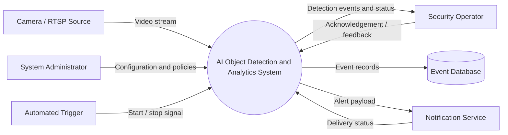
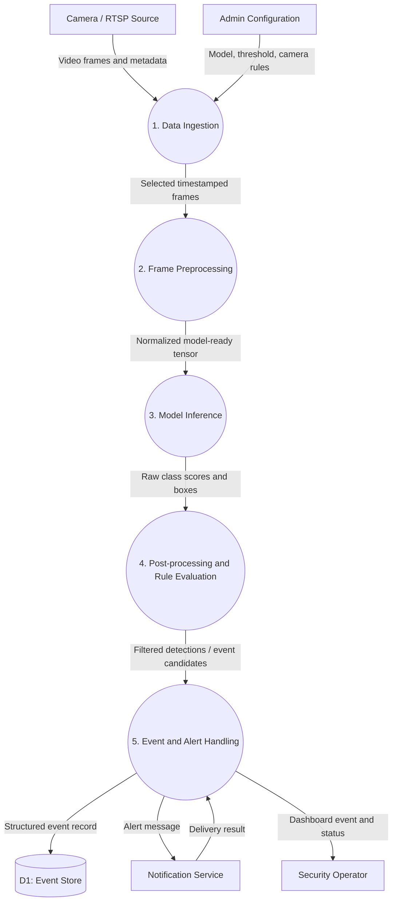

# AIR UNIVERSITY ISLAMABAD

## Faculty of Computing & AI | Department of Creative Technologies

**Course:** AI Project Design and Development (AI-316)  
**Lab:** 02 — System Requirements & Software Architecture for AI Projects  
**Lab Instructor:** Farhan Zafar Kayani  
**Student Name:** Sham Lal  
**Student ID:** 231183

# System Design Specification

## 1. Project Overview

### 1.1 Project Title
AI-Powered Object Detection and Surveillance Analytics System

### 1.2 Purpose
The system receives video from configured cameras, detects selected objects using a computer vision model, records relevant events, and sends alerts to authorized operators. It is intended as a prototype design; deployment must follow applicable privacy, security, and institutional policies.

### 1.3 Scope and Boundary
**Inside the system:** camera stream connection, frame sampling, preprocessing, model inference, detection filtering, event logging, alert generation, and configuration.

**Outside the system:** physical camera installation, network infrastructure, human response to alerts, identity verification, and external notification-provider availability.

## 2. Task 1 — Software Requirements

### 2.1 Functional Requirements

| ID | Requirement | Acceptance Criteria |
|---|---|---|
| FR-01 | The system shall ingest video from a configured RTSP stream or a local video source. | A valid source produces timestamped frames; connection failures are reported. |
| FR-02 | The system shall preprocess frames before inference. | Frames are resized and converted to the model's expected color/layout format. |
| FR-03 | The system shall detect configured object classes and return labels, confidence scores, and bounding boxes. | Each detection contains class, confidence in [0,1], and box coordinates. |
| FR-04 | The system shall create an event when a detection meets configured confidence and rule thresholds. | Matching events include camera ID, timestamp, class, and detection metadata. |
| FR-05 | The system shall persist event records and deliver configured operator alerts. | Events are stored; alert delivery status or failure is recorded. |

### 2.2 Non-Functional Requirements

| ID | Quality Attribute | Target / Constraint | Verification |
|---|---|---|---|
| NFR-01 | Detection performance | Prototype target: process at least 10 frames/second on the declared test device at the selected resolution; report measured results. | Benchmark a fixed test clip and record hardware, resolution, and FPS. |
| NFR-02 | Detection quality | Target mAP@0.5 of at least 0.80 on a representative, labeled validation set; this is a project goal, not a guaranteed result. | Evaluate against held-out annotations and report precision, recall, and mAP. |
| NFR-03 | Alert latency | Target 95th-percentile event-to-alert latency below 2 seconds on the test setup, excluding external provider delays. | Timestamp event creation and alert dispatch. |
| NFR-04 | Privacy and security | Restrict access by role, protect credentials, minimize retained video, and encrypt network transport where supported. | Review access controls, configuration, and retention behavior. |
| NFR-05 | Resource usage | Prototype target: application memory below 1.5 GB on the declared edge device; adapt frame sampling to available bandwidth. | Measure peak resident memory and network throughput during a test run. |

*Targets must be validated on the actual deployment hardware and dataset before being treated as service guarantees.*

## 3. Task 2 — System Boundary, Actors, and I/O

### 3.1 Primary Actors

| Actor | Role |
|---|---|
| Security Operator | Views events and receives alerts; acknowledges or escalates incidents. |
| System Administrator | Configures camera sources, detection classes, thresholds, users, and retention settings. |
| Camera / RTSP Source | Supplies video frames and stream metadata. |
| Automated Trigger | Starts processing based on schedule, motion trigger, or configured event. |
| Event Database | Stores event metadata and processing/alert status. |
| Notification Service | Delivers configured email, dashboard, or other approved alerts. |

### 3.2 Input and Output Mapping

| Type | Data | Description |
|---|---|---|
| Input | RTSP URL or video source | Configured camera stream or test video. |
| Input | Frame image | Image array with width, height, and color-channel information. |
| Input | Model configuration | Model path, class list, confidence threshold, and input size. |
| Input | Operational configuration | Camera ID, sampling interval, event rules, and retention policy. |
| Output | Detection result | Class label, confidence score, and bounding box coordinates `(x1, y1, x2, y2)`. |
| Output | Annotated frame | Optional preview with visualized detection boxes. |
| Output | Alert notification | Event summary, camera identifier, timestamp, and severity. |
| Output | Event log | Structured record of detections, processing status, and alert status. |

### 3.3 Operational Constraints

| Constraint | Design Consideration |
|---|---|
| Memory | Keep model and frame buffers within the device memory budget; use bounded queues. |
| Bandwidth | Sample frames or reduce stream resolution when network capacity is limited. |
| Connectivity | Reconnect with bounded retry/backoff and log unavailable sources. |
| Compute | Select model size and inference rate according to CPU/GPU capability. |
| Privacy | Avoid unnecessary continuous recording; apply access control and retention limits. |
| Reliability | A camera or alert-provider failure should not crash unrelated processing where possible. |

## 4. Task 3 — Data-Flow Diagrams

### 4.1 Level 0 — Context Diagram



### 4.2 Level 1 — Internal Data Flow



**DFD notation:** rectangles represent external entities, rounded process nodes represent transformations, cylinders represent data stores, and arrows represent data flows.

## 5. Task 4 — Modular Software Architecture

### 5.1 Module Responsibilities

| Module | Responsibility | Main Input | Expected Output |
|---|---|---|---|
| `DataIngestion` | Connect to a video source, read frames, attach timestamps, and release resources. | Source URI or camera configuration | Frame records or end-of-stream status |
| `ImagePreprocessor` | Resize, color-convert, and prepare frames for inference. | Image array and target dimensions | Processed image array |
| `ModelInferenceEngine` | Load the configured model and run inference. | Preprocessed image | List of detection objects |
| `AlertLogger` | Apply event logging and dispatch approved alerts. | Event record and alert destination | Persisted status / delivery result |

### 5.2 Suggested Project Layout

```text
AI316-Lab02/
├── ARCHITECTURE.md
└── src/
    ├── data_ingestion.py
    ├── image_preprocessor.py
    ├── model_inference_engine.py
    └── alert_logger.py
```

### 5.3 Interface Contracts

The following files define interfaces only. They are skeletons and do not perform real camera capture, inference, database writes, or notification delivery yet.

## 6. Assumptions and Future Enhancements

- A compatible camera stream and model weights will be supplied during implementation.
- Detection labels and operating thresholds will be selected for the intended use case.
- Model quality and latency will be measured on representative data and target hardware.
- Future work may add a dashboard, role-based access, health monitoring, and deployment automation.

## 7. Conclusion

This specification defines the requirements, system boundary, data flow, and modular interfaces for an AI-powered object detection and surveillance analytics prototype. The design separates ingestion, preprocessing, inference, and event handling to support testing, maintainability, and future extension.
